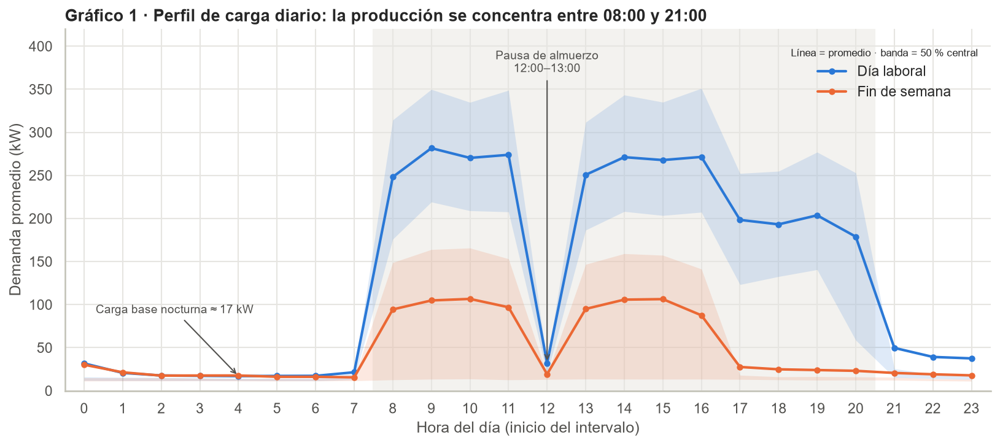
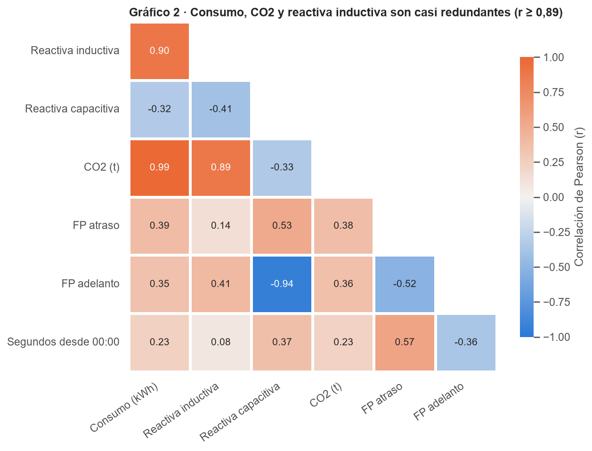
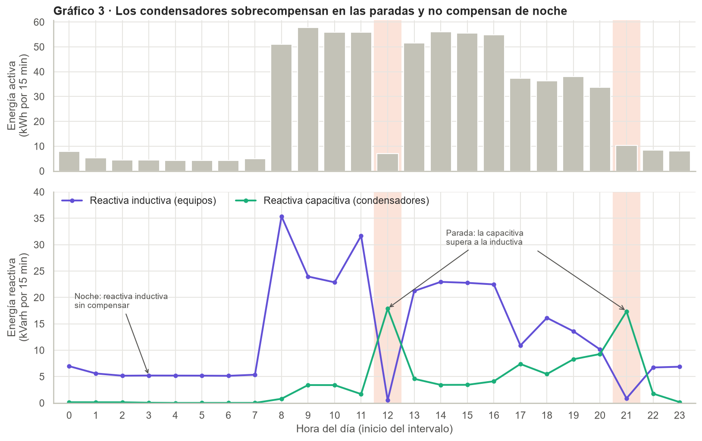
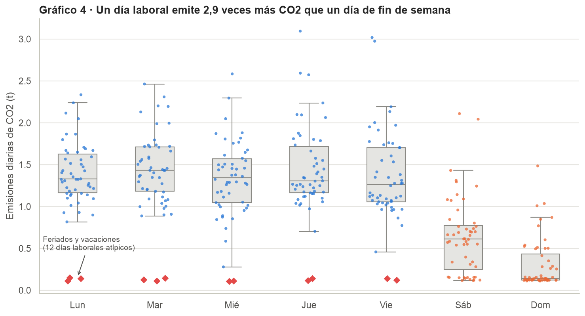
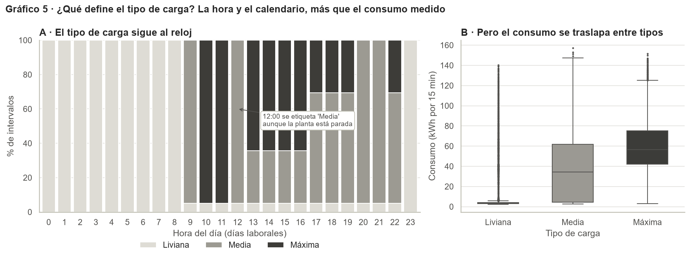

# Energía, reactiva y CO2 en una planta siderúrgica

Proyecto del curso **Data Analytics en Gestión Industrial**. Analizamos un año de consumo eléctrico de una planta de acero para identificar dónde se pierden dinero y emisiones, y preparar el modelado analítico.

**Hallazgo principal:** la carga liviana representa solo el 16 % de la energía, pero genera el 69 % del costo de penalización por energía reactiva. Los datos son consistentes con bancos de condensadores que operan a destiempo: sobrecompensan en las paradas y no compensan de madrugada.

| Fase | Contenido | Estado |
|---|---|---|
| 1 | Contexto, ficha técnica y justificación | ✅ Completa |
| 2 | Pipeline ETL y calidad de datos | ✅ Completa |
| 3 | Análisis exploratorio (EDA) e hipótesis | ✅ Completa |
| 4 | Clustering, clasificación, PCA y LDA | ⏳ Pendiente |
| 5 | Dashboard y propuesta estratégica | ⏳ Pendiente |

---

## Dataset

| Campo | Detalle |
|---|---|
| Nombre | Steel Industry Energy Consumption |
| Fuente | [UCI Machine Learning Repository](https://archive.ics.uci.edu/dataset/851/steel+industry+energy+consumption) |
| Planta | DAEWOO Steel Co. Ltd., Gwangyang (Corea del Sur) |
| Periodo | 1 de enero – 31 de diciembre de 2018, intervalos de 15 minutos |
| Tamaño | 35.041 filas × 11 columnas (2,7 MB) |
| Licencia | [Creative Commons Attribution 4.0 (CC BY 4.0)](https://creativecommons.org/licenses/by/4.0/) |

**Cita:** V E, S., Shin, C., & Cho, Y. (2021). *Steel Industry Energy Consumption* [Dataset]. UCI Machine Learning Repository. https://doi.org/10.24432/C52G8C

---

## Estructura del repositorio

```
steel-energy-analytics/
├── data/
│   ├── raw/Steel_industry.csv        # Capa bronce: dato original, nunca se modifica
│   └── processed/
│       ├── steel_limpio.csv          # Capa plata: 35.040 filas × 26 columnas
│       └── kpi_diario.csv            # Capa oro: 365 días con KPIs agregados
├── notebooks/
│   ├── 01_ETL.ipynb                  # Fase 2: ingesta, limpieza, KPIs y exportación
│   └── 02_EDA.ipynb                  # Fase 3: estadística descriptiva, 5 gráficos e hipótesis
├── reports/figures/                  # Gráficos exportados (PNG)
├── docs/                             # Fase 1, diccionarios de datos y reporte de calidad
├── requirements.txt                  # Librerías y versiones exactas
└── README.md
```

---

## Cómo reproducir el proyecto

Requisitos: Python 3.10 o superior y Git.

```bash
# 1. Clonar el repositorio
git clone https://github.com/[usuario]/steel-energy-analytics.git
cd steel-energy-analytics

# 2. Crear y activar el entorno virtual
python -m venv .venv
.venv\Scripts\activate          # Windows
source .venv/bin/activate       # Mac / Linux

# 3. Instalar las dependencias
pip install -r requirements.txt
```

Luego abre los notebooks en VS Code o Jupyter, selecciona el kernel `.venv` y ejecútalos **en orden** con *Run All*:

1. `notebooks/01_ETL.ipynb` genera los archivos de `data/processed/` y `docs/`.
2. `notebooks/02_EDA.ipynb` genera los gráficos de `reports/figures/`.

La semilla aleatoria está fijada (`SEED = 42`) para que los resultados sean reproducibles.

---

## Fase 2: pipeline ETL

| Problema encontrado | Decisión |
|---|---|
| Carácter invisible (BOM) en el encabezado | Lectura con `encoding="utf-8-sig"` |
| 365 marcas de medianoche fechadas con un día de atraso | Se suma un día; después, el 99,99 % de los intervalos queda a 15 min exactos |
| 1 marca de tiempo duplicada (31-12-2018 20:00) | Se conserva el registro que está en secuencia |
| 1 falla del medidor (todas las mediciones en cero) | Interpolación lineal, marcada en la columna `registro_imputado` |
| 328 picos de consumo (método IQR) | Se conservan por ser producción real; se marcan en `pico_consumo` |

Además se validaron 5 reglas físicas y lógicas, incluida la fórmula del factor de potencia, sin violaciones.

**Variables creadas (15):** tiempo (fecha, hora, mes, turno), demanda (kW y factor de carga diario), reactiva (ratio Q/P, reactiva penalizable y bandera de penalización), costos y CO2 estimado, y banderas de calidad. El diccionario completo antes/después está en `docs/`.

**Supuestos declarados:**
- Tarifa ilustrativa de 0,10 USD/kWh (parámetro modificable en el notebook).
- Se penaliza la reactiva inductiva que supera el 50 % de la activa, según el criterio de la regulación colombiana (CREG 015 de 2018).
- Turnos de 06-14, 14-22 y 22-06 h.

---

## Fase 3: principales hallazgos

| Gráfico | Hallazgo |
|---|---|
|  | La planta opera en tres regímenes fijos: carga base nocturna de ≈ 17 kW, producción plena de 8 a 16 h y una pausa total a las 12 h. |
|  | Consumo y CO2 (r = 0,99) y reactiva capacitiva y FP en adelanto (r = −0,94) son pares redundantes, lo que justifica el PCA. |
|  | En las paradas de las 12 y 21 h la reactiva capacitiva supera a la inductiva; de madrugada no hay compensación. |
|  | Un día laboral emite 2,9 veces más CO2 que uno de fin de semana. Los 12 días laborales atípicos coinciden con feriados coreanos. |
|  | El tipo de carga sigue franjas horarias: una regla con hora, mes y día acierta el 93,3 %, que será la línea base de la Fase 4. |

**Acciones propuestas:** controlador automático de factor de potencia, protocolo de apagado de la carga base en domingos y feriados, y escalonamiento de los arranques de 8:00 y 13:00.

Las hipótesis que se evaluarán en la Fase 4 están al final de `notebooks/02_EDA.ipynb`.

---

## Herramientas

Python · pandas · NumPy · matplotlib · seaborn · scikit-learn · Jupyter · VS Code · Git y GitHub

## Uso de inteligencia artificial

Siguiendo la política de integridad académica del curso, declaramos que se usó un asistente de IA (Claude, de Anthropic) como apoyo para estructurar el código, depurar errores y redactar documentación. Todas las decisiones fueron revisadas por el equipo, que puede explicar cada línea del código.

## Integrantes

- [Nombre del integrante 1]
- [Nombre del integrante 2]
- [Nombre del integrante 3]
