# Energía, reactiva y CO2 en una planta siderúrgica

Proyecto del curso **Data Analytics en Gestión Industrial**. Analizamos un año de consumo eléctrico de una planta de acero para identificar dónde se pierden dinero y emisiones, y construimos modelos analíticos para segmentar su operación y anticipar su tipo de carga.

**Hallazgos principales:**
- La carga liviana representa solo el 16 % de la energía, pero genera el **69 % del costo de penalización** por energía reactiva. Los datos son consistentes con bancos de condensadores que operan a destiempo: sobrecompensan en las paradas y no compensan de madrugada.
- El clustering identificó **89 días laborales con el factor de potencia deteriorado** (de agosto a noviembre) que generan el **39 % del costo de penalización**.
- Un Random Forest predice el tipo de carga con un **F1 de 96,6 %** (validado con días completos no vistos) y reduce en **85 % el costo del error** frente a una regla basada solo en el horario.

| Fase | Contenido | Estado |
|---|---|---|
| 1 | Contexto, ficha técnica y justificación | ✅ Completa |
| 2 | Pipeline ETL y calidad de datos | ✅ Completa |
| 3 | Análisis exploratorio (EDA) e hipótesis | ✅ Completa |
| 4 | Clustering, clasificación, PCA y LDA | ✅ Completa |
| 5 | Dashboard y propuesta estratégica | ⏳ Pendiente |

---

## Dataset

| Campo | Detalle |
|---|---|
| Nombre | Steel Industry Energy Consumption |
| Fuente | [UCI Machine Learning Repository](https://archive.ics.uci.edu/dataset/851/steel+industry+energy+consumption) |
| Planta | DAEWOO Steel Co. Ltd., Gwangyang (Corea del Sur) |
| Periodo | 1 de enero – 31 de diciembre de 2018, intervalos de 15 minutos |
| Tamaño | 35.041 filas × 11 columnas (2,7 MB) |
| Licencia | [Creative Commons Attribution 4.0 (CC BY 4.0)](https://creativecommons.org/licenses/by/4.0/) |

**Cita:** V E, S., Shin, C., & Cho, Y. (2021). *Steel Industry Energy Consumption* [Dataset]. UCI Machine Learning Repository. https://doi.org/10.24432/C52G8C

---

## Estructura del repositorio

```
steel-energy-analytics/
├── data/
│   ├── raw/Steel_industry.csv            # Capa bronce: dato original, nunca se modifica
│   └── processed/
│       ├── steel_limpio.csv              # Capa plata: 35.040 filas × 26 columnas
│       ├── kpi_diario.csv                # Capa oro: 365 días con KPIs agregados
│       └── kpi_diario_clusters.csv       # Capa oro + perfil de operación de cada día
├── notebooks/
│   ├── 01_ETL.ipynb                      # Fase 2: ingesta, limpieza, KPIs y exportación
│   ├── 02_EDA.ipynb                      # Fase 3: estadística descriptiva, 5 gráficos e hipótesis
│   └── 03_Modelado.ipynb                 # Fase 4: clustering, PCA, clasificación y LDA
├── models/
│   └── rf_tipo_carga.joblib              # Modelo final (Random Forest) para el dashboard
├── reports/figures/                      # Gráficos exportados (PNG), del g1 al g12
├── docs/                                 # Documentos de fases, diccionarios, calidad y resultados
├── requirements.txt                      # Librerías y versiones exactas
└── README.md
```

---

## Cómo reproducir el proyecto

Requisitos: Python 3.10 o superior y Git.

```bash
# 1. Clonar el repositorio
git clone https://github.com/mariacaro-freefire/steel-energy-analytics.git
cd steel-energy-analytics

# 2. Crear y activar el entorno virtual
python -m venv .venv
.venv\Scripts\activate          # Windows
source .venv/bin/activate       # Mac / Linux

# 3. Instalar las dependencias
pip install -r requirements.txt
```

Luego abre los notebooks en VS Code o Jupyter, selecciona el kernel `.venv` y ejecútalos **en orden** con *Run All*:

1. `notebooks/01_ETL.ipynb` genera los archivos de `data/processed/` y `docs/`.
2. `notebooks/02_EDA.ipynb` genera los gráficos 1 a 5 de `reports/figures/`.
3. `notebooks/03_Modelado.ipynb` genera los gráficos 6 a 12, las tablas de resultados de `docs/` y el modelo de `models/`. La validación cruzada tarda unos minutos.

La semilla aleatoria está fijada (`SEED = 42`) para que los resultados sean reproducibles.

---

## Fase 2: pipeline ETL

| Problema encontrado | Decisión |
|---|---|
| Carácter invisible (BOM) en el encabezado | Lectura con `encoding="utf-8-sig"` |
| 365 marcas de medianoche fechadas con un día de atraso | Se suma un día; después, el 99,99 % de los intervalos queda a 15 min exactos |
| 1 marca de tiempo duplicada (31-12-2018 20:00) | Se conserva el registro que está en secuencia |
| 1 falla del medidor (todas las mediciones en cero) | Interpolación lineal, marcada en la columna `registro_imputado` |
| 328 picos de consumo (método IQR) | Se conservan por ser producción real; se marcan en `pico_consumo` |

Además se validaron 5 reglas físicas y lógicas, incluida la fórmula del factor de potencia, sin violaciones.

**Variables creadas (15):** tiempo (fecha, hora, mes, turno), demanda (kW y factor de carga diario), reactiva (ratio Q/P, reactiva penalizable y bandera de penalización), costos y CO2 estimado, y banderas de calidad. El diccionario completo antes/después está en `docs/`.

**Supuestos declarados:**
- Tarifa ilustrativa de 0,10 USD/kWh (parámetro modificable en el notebook).
- Se penaliza la reactiva inductiva que supera el 50 % de la activa, según el criterio de la regulación colombiana (CREG 015 de 2018).
- Turnos de 06-14, 14-22 y 22-06 h.

---

## Fase 3: principales hallazgos

| Gráfico | Hallazgo |
|---|---|
| 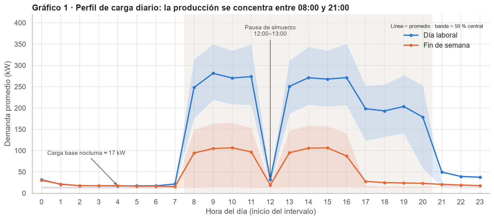 | La planta opera en tres regímenes fijos: carga base nocturna de ≈ 17 kW, producción plena de 8 a 16 h y una pausa total a las 12 h. |
| 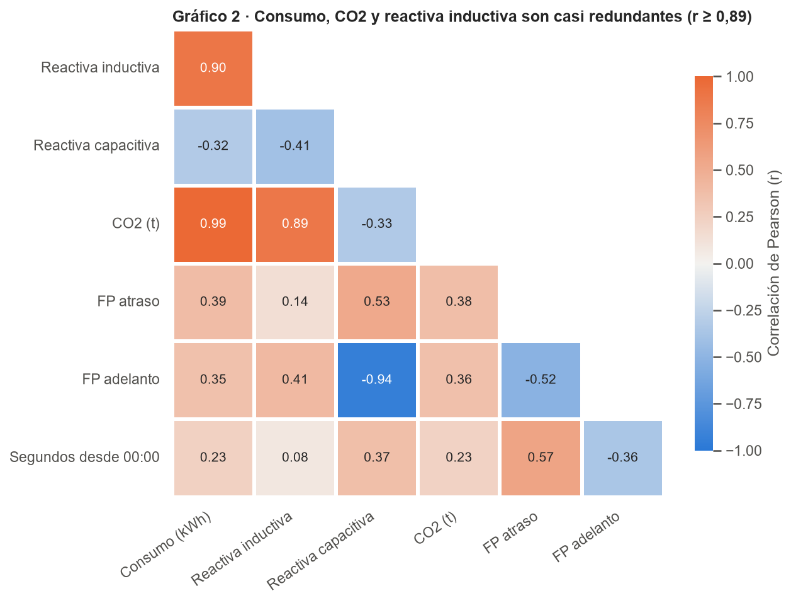 | Consumo y CO2 (r = 0,99) y reactiva capacitiva y FP en adelanto (r = −0,94) son pares redundantes, lo que justifica el PCA. |
| 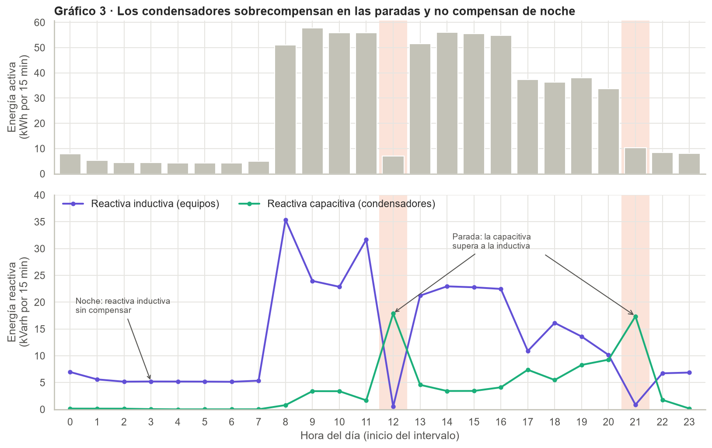 | En las paradas de las 12 y 21 h la reactiva capacitiva supera a la inductiva; de madrugada no hay compensación. |
| 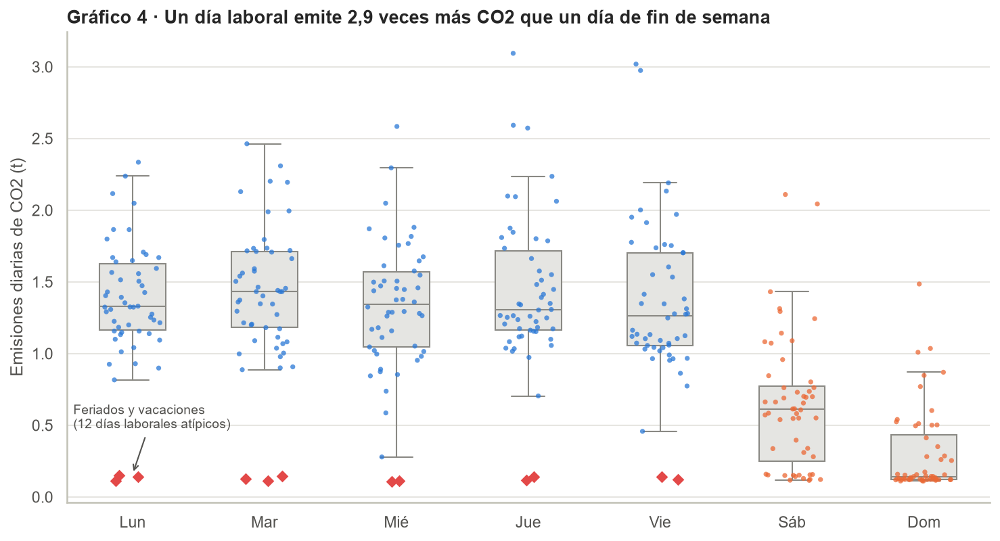 | Un día laboral emite 2,9 veces más CO2 que uno de fin de semana. Los 12 días laborales atípicos coinciden con feriados coreanos. |
| 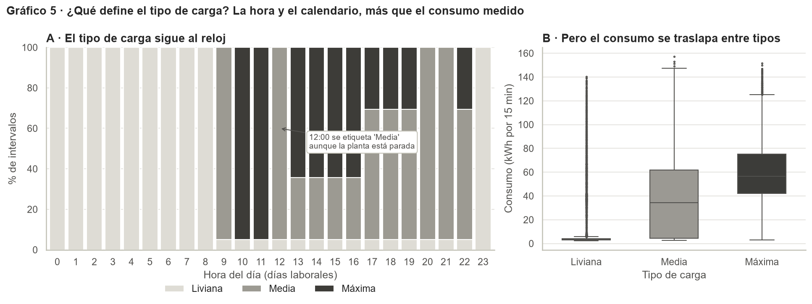 | El tipo de carga sigue franjas horarias: una regla con hora, mes y día acierta el 93,3 %, que es la línea base de la Fase 4. |

**Acciones propuestas:** controlador automático de factor de potencia, protocolo de apagado de la carga base en domingos y feriados, y escalonamiento de los arranques de 8:00 y 13:00.

---

## Fase 4: modelado analítico

### Clustering (K-means sobre los 365 días)

Se agruparon los días con 4 variables estandarizadas: consumo, demanda máxima, factor de carga y % de intervalos penalizados. Se eligió **k = 4** por el codo de la inercia y por ser el segundo mejor coeficiente de silueta (0,449); k = 2 solo separaba "produce / no produce". El resultado es estable con otras semillas (ARI = 1,0) y coincide en un 68 % con el clustering jerárquico de Ward.

| Perfil | Días | Consumo (kWh/día) | % penalizado | % del costo de penalización |
|---|---|---|---|---|
| Sin producción | 57 | 380 | 43,9 % | 8,4 % |
| Producción reducida | 99 | 1.837 | 47,4 % | 20,4 % |
| **Producción con FP deteriorado** | **89** | **3.000** | **70,0 %** | **38,7 %** |
| Producción plena | 120 | 4.076 | 50,3 % | 32,5 % |

| | |
|---|---|
| 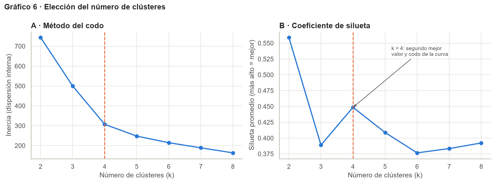 | 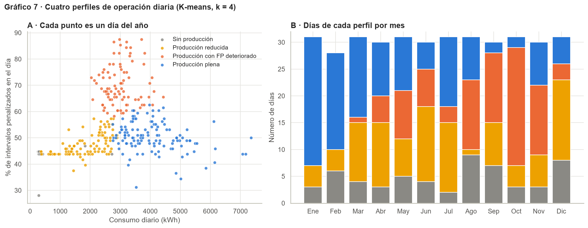 |

### PCA

Sobre las 6 variables eléctricas estandarizadas, **dos componentes explican el 92,3 % de la varianza** (criterio de Kaiser y codo). PC1 representa la **intensidad de producción** (consumo, reactiva inductiva y CO2) y PC2 la **compensación de reactiva** (factor de potencia y reactiva capacitiva). Se usó para visualizar los datos en 2D y confirmar variables redundantes.

| | |
|---|---|
| 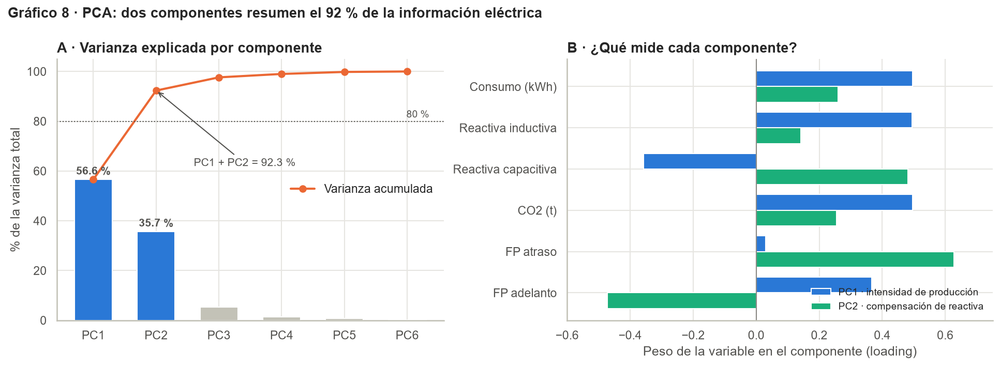 | 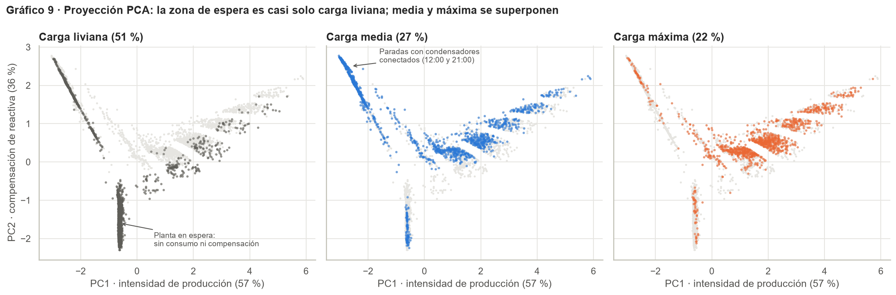 |

### Clasificación del tipo de carga

Se compararon 3 modelos (regresión logística, kNN y Random Forest) con dos conjuntos de variables: **A** (calendario + eléctricas) y **B** (solo eléctricas). División 75/25 estratificada, con una regla basada en el horario como línea base y una matriz de costo que penaliza más no anticipar una carga máxima.

| Modelo | Accuracy | F1 macro | ROC-AUC | Costo del error | F1 validado por día |
|---|---|---|---|---|---|
| **A · Random Forest** | **0,986** | **0,986** | **0,999** | **0,023** | **0,966** |
| Línea base · Regla del reloj | 0,925 | 0,924 | — | 0,153 | — |
| A · kNN | 0,881 | 0,856 | 0,975 | 0,212 | — |
| A · Regresión logística | 0,749 | 0,692 | 0,901 | 0,420 | — |
| B · kNN | 0,745 | 0,676 | 0,887 | 0,444 | — |
| B · Random Forest | 0,732 | 0,667 | 0,881 | 0,464 | 0,643 |
| B · Regresión logística | 0,730 | 0,659 | 0,866 | 0,477 | — |

| | |
|---|---|
| 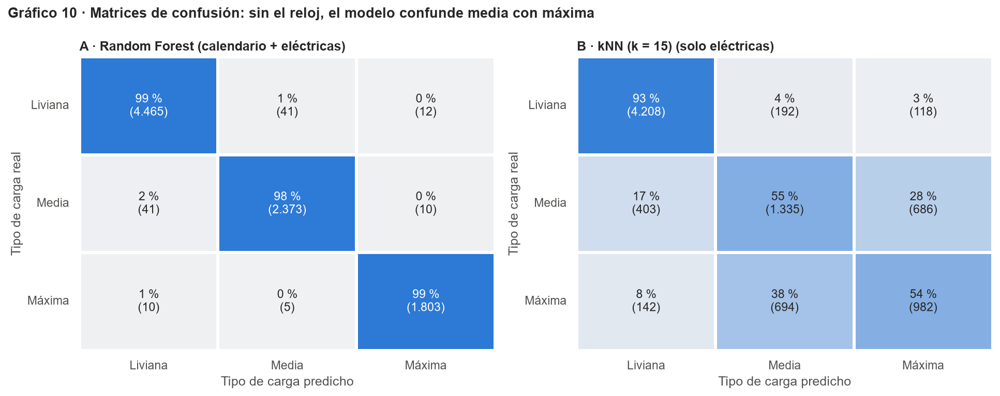 | 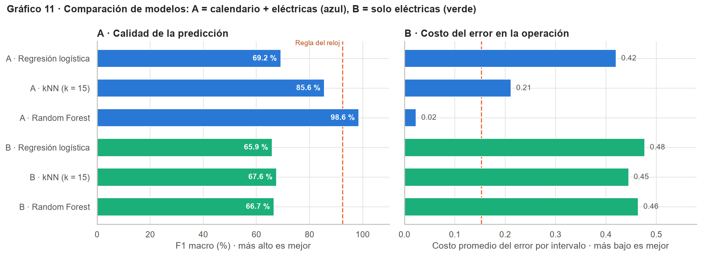 |

### LDA

Aplicado como reducción supervisada a 2 ejes antes de clasificar. Con las variables eléctricas, el F1 baja **como máximo 1,1 puntos** (de 5 variables a 2 ejes). Con calendario cae hasta 28 puntos, porque el efecto de la hora no es lineal. El primer eje (92 % de la separación) distingue la carga liviana de la producción y lo domina el factor de potencia; el segundo (8 %) apenas separa la carga media de la máxima.

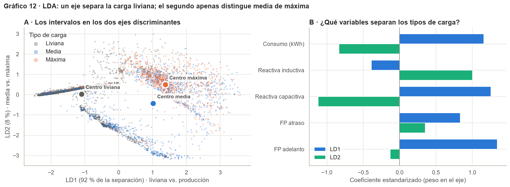

### Modelo elegido

**Random Forest con calendario y variables eléctricas, sin LDA**: es el único que supera la línea base, mantiene un F1 de 96,6 % con días que nunca vio y reduce el costo del error en 84,7 % (el error más caro, no anticipar una carga máxima, baja de 134 a 10 casos en el conjunto de prueba).

**Limitaciones:** el modelo se apoya sobre todo en la hora, así que debe reentrenarse si cambian las franjas horarias; solo con variables eléctricas no se distingue bien la carga media de la máxima; y los datos cubren un solo año.

### Evaluación de hipótesis

| Hipótesis | Técnica | Resultado |
|---|---|---|
| H1 · Los días forman al menos 3 perfiles y los feriados caen en el de menor consumo | Clustering | ✅ Aceptada |
| H2 · El clúster sin producción tiene el mayor % penalizado | Clustering | ❌ Rechazada: el mayor es "FP deteriorado" |
| H3 · Un modelo con calendario supera la regla del reloj | Clasificación | ✅ Aceptada |
| H4 · Solo con variables eléctricas se supera el azar; el error es media vs. máxima | Clasificación | ✅ Aceptada |
| H5 · Dos componentes explican al menos el 80 % de la varianza | PCA | ✅ Aceptada |
| H6 · El FP es lo que más separa las clases; con LDA la métrica cae menos de 5 puntos | LDA | ✅ Aceptada (solo con variables eléctricas) |

Las tablas completas están en `docs/tabla_metricas_modelos.csv` y `docs/evaluacion_hipotesis.csv`.

---

## Herramientas

Python · pandas · NumPy · matplotlib · seaborn · scikit-learn · joblib · Jupyter · VS Code · Git y GitHub

## Uso de inteligencia artificial

Siguiendo la política de integridad académica del curso, declaramos que se usó un asistente de IA (Claude, de Anthropic) como apoyo para estructurar el código, depurar errores y redactar documentación. Todas las decisiones fueron revisadas por el equipo, que puede explicar cada línea del código.

## Integrantes

- Maria
- Jaime
- Jonatan
